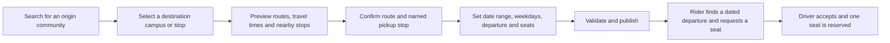
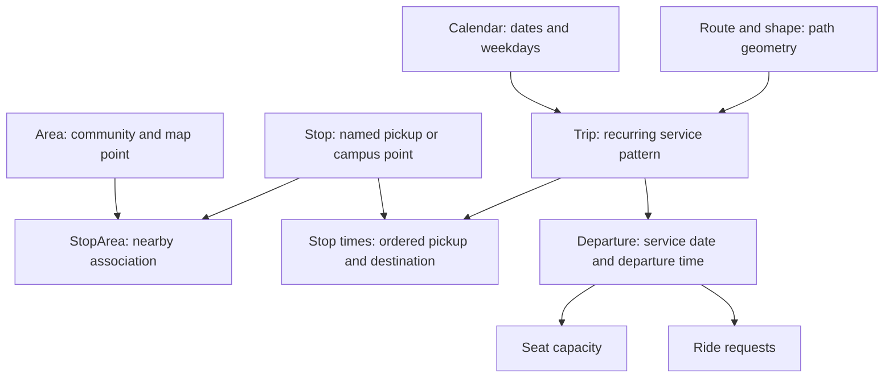

# NS Journey Project Brief

Build a web application that helps students share rides to educational institutions across Nova Scotia. Start with one campus and a verified set of nearby meetup stops. A student driver should be able to publish a recurring commute, and a student rider should be able to find one departure, request a seat, and see the driver's decision.

## Users and first release

- **Visitors** explore the campus and meetup stops on a public map.
- **Drivers** sign in, plan and publish a recurring one-way commute, and review requests in My Journey.
- **Riders** sign in, search for trips by destination and date, and track their requests in My Journey.
- **Administrators** curate the location data and prepare test accounts for the demonstration.

Include weekly recurrence within a date range. Treat repeated departures within one day as an extension that uses the same service model. Defer account self-registration, password recovery, automated return trips, and boarding codes.

The first release is a responsive web app for desktop and mobile browsers, including Chrome on Android and Safari on iPhone and iPad. Core map, offer, and booking tasks must work with touch input on phone and tablet screens.

## Driver offer workflow

| Offer input | Required behaviour |
| --- | --- |
| Origin area | Search GeoNames communities by name and county. Select a stable area ID and show the area's approximate location. |
| Destination stop | Select a stable stop ID from the campus and meetup dataset. Keep the selected campus discoverable for journeys starting outside its local area. |
| Route and pickup | Show the recommended route, alternatives when available, distance, estimated duration, and nearby stops. Let the driver confirm a route and a named pickup stop. |
| Service calendar | Select inclusive start and end dates, one or more weekdays, and a departure time in Halifax local time. The calendar describes which dates the commute runs. |
| Seats | Enter a positive seat count. Track bookings separately for each dated departure so a Monday booking preserves Wednesday's availability. |
| Optional frequency extension | Provide both a final departure-window time and a positive interval in minutes. Each departure in that window needs its own seat availability. |

For the demo, a driver can choose **Woodlawn, Halifax County**, and **NSCC Akerley Campus**, then publish a Monday, Wednesday, and Friday service at 08:30 with three seats. Choose a named pickup stop distinct from the campus when preparing the demo data.

## Database and seed data

Use Django migrations to create the schema in PostgreSQL with PostGIS. Keep geographic areas, physical stops, and area-to-stop links distinct. Use point geometry for locations and line geometry for routes. Store the pickup and destination as ordered stop times so the rider can distinguish where to board and where to get off.

1. **Prepare the location datasets.** Use `data/geonames.csv` for community names, counties, stable geographic IDs, and coordinates. Use `data/stops.csv` for campuses and meetup points. Each stop needs a stable ID, name, latitude, and longitude. Add useful descriptions, links, and an icon or fallback. Verify the pilot stops against their actual pickup locations.
2. **Validate before import.** Check for missing IDs and names, duplicate IDs, coordinates outside the intended region, and missing or case-mismatched image references. Record the provenance of added or corrected locations and confirm the source coordinate reference system before assigning or transforming coordinates.
3. **Load and link the records.** Import areas and stops by stable ID, then link nearby pairs using PostGIS. The development importer uses a 2 km radius when invoked by Compose. Use those links for discovery and suggestions. A stop's proximity to an origin is a separate question from whether it is a valid destination or lies near the driving route.
4. **Verify a clean start and a rerun.** Confirm both datasets load, check a known area and campus, and use the API to verify searches and map points. Rerunning the importer should preserve unique IDs and links. Define how stale links are removed when a point moves or a radius changes.

See the [workspace audit](project-workspace-audit.md) for the import command, schema findings, and API differences.

## Backend API and frontend integration

| Capability | API responsibility |
| --- | --- |
| Location discovery | Provide paginated GeoJSON search for areas and stops, including nearby-stop lookup. Document how the client reads feature IDs and coordinates. |
| Route preview | Validate the endpoints, obtain routes from OpenRouteService, and use PostGIS to identify seeded stops near the returned geometry. Return GeoJSON, distance, duration, and stops without creating an offer. |
| Publish an offer | Validate the dates, weekdays, stops, route choice, and capacity. Persist the calendar, trip, route shape, ordered stop times, and initial availability consistently. Return the created trip ID and map geometry. |
| Find a departure | Expand recurring services into dated departures within the requested search range. Return only departures that match the rider's filters, with their remaining seats. |
| Request and reserve | Record pending requests for specific departures. Verify that the assigned driver accepts, then change request status and reserve a seat in one transaction. |
| My Journey | Return offers and requests visible to the signed-in user. Keep account details and unrelated users' records private. |

Build the browser interface with Vite, Tailwind, Leaflet, and MapLibre. Use Django REST Framework for the API. Set up session authentication and CSRF for browser writes, and define how local Docker and Vite origins communicate. Keep the OpenRouteService key on the server. Show useful outcomes for empty searches, invalid schedules, and routing errors.

## Milestones and deliverables

| Milestone | Demonstrate |
| --- | --- |
| 1. Create and seed the database | Apply migrations to a clean PostGIS database, import areas and stops, verify their links, and display pilot stops on the map through the API. |
| 2. Plan and publish a service | Search for locations, preview a route, enter a calendar and seat count, publish an offer, and inspect the saved geometry and stop times. |
| 3. Complete booking | Find a dated departure, request a seat, accept it as the assigned driver, and show the result in the rider's My Journey view. |
| 4. Verify and hand off | Submit source code, migrations, seed data and provenance, a Docker/Vite setup guide, an API contract, automated checks, mobile browser test results, and a short demo. |

## Acceptance criteria

- A clean database and a repeat import both produce unique, searchable area and stop records. The map renders the expected pilot locations even when a stop has no custom icon.
- A service offered on Monday, Wednesday, and Friday appears on those dates within its calendar range. It stays out of results for Tuesday and dates outside the range.
- The published ride shows the confirmed route, a real pickup stop, the campus destination, and a departure time and estimated arrival. A failed route calculation leaves no partially saved offer.
- Accepting one request updates its status and removes one seat from that departure. Another departure keeps its capacity. A repeat acceptance or two competing requests for the last seat cannot overbook it.
- A rider sees their request, the assigned driver sees the requests for their trips, and unrelated accounts cannot see or accept those requests.
- In Chrome on Android and Safari on iPhone and iPad, users can navigate, use the map, select search results, enter service dates and times, and submit or accept ride requests using touch. The pages fit the screen without horizontal scrolling.
- Another student can start the app with the supplied instructions and reproduce the driver and rider demonstration with separate test accounts.
