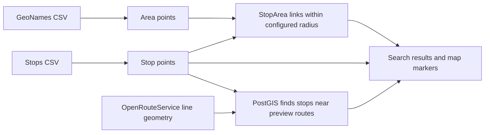

# NS Journey Workspace Audit

This source audit explains how the driver offer prototype, browser application, API, and seed data inform the [student project brief](project-brief.md). Counts come from parsing the CSV files. The database import, external route requests, and browser booking workflow were reviewed in source.

## Driver offer prototype

The [offer form](../tests/client/test_offer.html) checks session status and expects the API on the same origin. Search starts at two characters and reads GeoJSON features from the paginated response. The driver selects a community by area ID and a destination by stop ID. The map plots both locations, then posts longitude and latitude pairs to the route preview endpoint. Preview draws the routes returned by OpenRouteService and displays contextual stop markers. The form sends dates, selected weekdays, departure time, and seat count. It adds the end time and headway in minutes when both frequency fields are filled.

| Finding | Implication for the new project |
| --- | --- |
| The prototype posts to `/offers/`. Django registers `/offer/`. The response handler reads `data.routes.length` before checking success. The create view uses the input serializer and does not explicitly return the trip representation expected by the page. | Agree on the route and response schema. Test that publication returns a trip ID and map-ready shape, and that validation errors render in the browser. |
| Destination search sends `area_id`. The stop view does not apply that parameter. The 2 km area links describe local proximity, so filtering all destination choices by the origin's area could hide valid campuses. | Keep statewide destination search available. If an area filter is added, document it as an explicit local search option. |
| Clicking a route changes a hidden geometry field. The publish payload omits that field. The offer serializer makes its own routing request and saves the first geometry. | Link the chosen preview route to publication and validate the selection server-side. |
| The form exposes Monday through Friday. The serializer accepts all seven days, and the schema represents all seven. The server does not enforce a nonempty weekday set or date and time ordering across fields. | Choose the visible schedule options and enforce the same rules in the browser and API. Test empty weekdays, reversed dates, and incomplete or invalid frequency settings. |
| The publish serializer writes both stop times against the destination ID. The prototype displays contextual stops but does not submit a separate pickup ID. | Make a named pickup an explicit input and save the correct stop at each sequence position. Check the route and arrival estimate against the selected stops. |

The frontend repository supplies a public map, informational pages, and a My Journey placeholder. Its public map uses a sample location. The [older test My Journey page](../tests/client/myjourney.html) uses legacy `/api/v1/stn/` endpoints on port 8000. Use it as a route-search reference when designing the new client. Verify current API calls against the [Django URL configuration](../journey/urls.py) and [browser origin settings](../cptn_api/settings.py).

The frontend sets a mobile viewport and provides responsive navigation. The public map disables standard dragging when Leaflet detects a mobile browser. Verify that touch users can explore locations and use route controls while still being able to scroll the page. Chrome on Android and Safari on iPhone and iPad are acceptance targets. Device testing remains open.

## Database and seed pipeline



| Dataset | Observed contents | Imported fields |
| --- | --- | --- |
| [GeoNames CSV](../data/geonames.csv) | 22,890 rows. Stable source key `cgndb_key`. | Area name, county, location narrative, coordinates, and point geometry. |
| [Stops CSV](../data/stops.csv) | 286 rows. Stable `stop_id`. Example `1000` is NSCC Akerley Campus. | Name, description, coordinates, URL, icon filename, and point geometry. CSV `zone_id` is currently unused by the importer. |

Both files have unique, nonblank IDs and parseable coordinates within global latitude and longitude bounds. These checks establish basic file integrity. Pilot stop coordinates and source datum still need to be confirmed. The area columns are named `nad83_lat` and `nad83_lon`; the importer assigns SRID 4326 directly. Two populated icon references need normalization for case-sensitive hosts: `DalhousieUniversity.png ` has trailing whitespace and `mountsaintvincent.png` differs in case from `MountSaintVincent.png`. Treat stop descriptions as text or sanitize formatting before rendering map popups. Keep [older preparation files](../data/ss/) and [sample feed files](../data/sample-feed/) as references. The startup command imports the two CSVs listed above.

The [Compose stack](../docker-compose.yml) supplies PostGIS, and the [entrypoint](../docker-entrypoint.sh) waits for the database, runs migrations, creates the configured superuser, then imports data. The [importer](../journey/management/commands/import_cptn_data.py) defaults to 15 km when no distance is provided. Compose passes **2 km**. The route preview uses a separate **450 m** distance from the combined returned routes, and the point-based nearby-stop API defaults to **500 m**. These lookups answer different questions.

After starting the API using the [local setup guide](../README.md), run this from the backend repository to repeat the development import.

```sh
docker compose exec cptn_api python manage.py import_cptn_data --stops data/stops.csv --areas data/geonames.csv --dist 2
```

The importer upserts points and adds missing area-to-stop pairs. It does not reconcile links made stale by changed coordinates, deleted source rows, or a reduced radius. For a reproducible student project, define source ownership and stale-link handling, and verify the counts and an expected nearby pair after a repeat import.

## API and schema development

The current endpoints use the prefix `/api/v1/journey/`.

| Current endpoint | Development work for the brief |
| --- | --- |
| `GET areas/?search=...`, `GET stops/?search=...`, `GET stops/nearby/` | Document response shapes and parameter semantics. Verify a known map point and test empty results and coordinate validation. |
| `POST get-route/` | Validate coordinate bounds, define timeout and failure responses, and preserve the route the driver selects. |
| `POST offer/` | Validate referenced locations and schedule rules before writing. Return the persisted trip, geometry, and ordered stop times. Route and shape identity should remain correct when one driver offers multiple destinations. |
| `GET trips/` | Add destination and service-date search. Current filtering uses route-name text. |
| `POST requests/` and `POST requests/{id}/accept/` | Scope requests to the rider and assigned driver. Reserve capacity transactionally and prevent repeated acceptance or overbooking. Review the identity fields before returning request data. |

The [models](../journey/models.py) currently keep a calendar ID as text on the trip, with capacity and requests linked to the trip itself. That schema cannot distinguish Monday's booking from Wednesday's on the same recurring service. The brief proposes dated departures, each with its own capacity and requests. The team should document how it identifies departures and maintains referential integrity between the trip and calendar. Use migrations and constraints to make that design reproducible, then verify it through the API and browser. [Offer serializer](../journey/serializers.py) · [API views](../journey/views.py)
